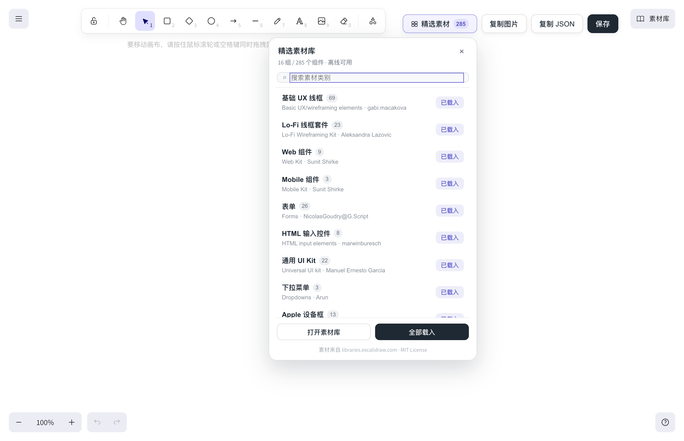
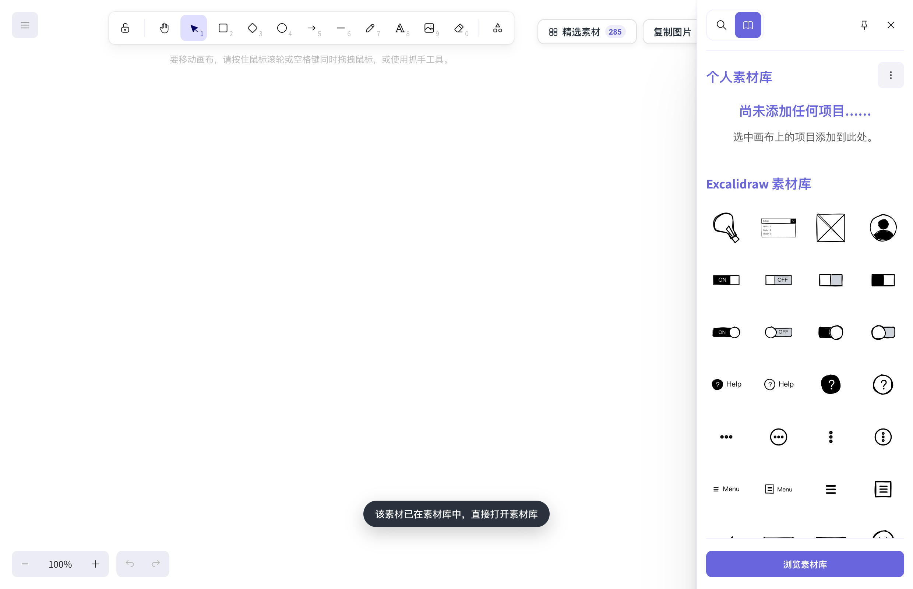

# UI 草图内置素材库

## 结论

画板现在随 App 离线内置 **16 组 Excalidraw 官方素材库**：

- **285 个素材组件**
- **1531 个图形元素**
- 总计原始 `.excalidrawlib` 约 **1.4 MB**，转换后的 JS 数据约 **0.9 MB**
- 所有素材均为 **MIT License**
- 不请求 `libraries.excalidraw.com`、GitHub、CDN 或任何网络资源

打开画板后首次启动会把这些组件合并进 Excalidraw 素材库；顶部工具栏的
「素材库」按钮可直接使用。另在应用自有的右上角操作区增加「精选素材」入口，
可按类别浏览、搜索、查看来源与载入状态。



## 内置清单

| 中文分类 | 原始库名 | 组件 | 元素 |
|---|---|---:|---:|
| 基础 UX 线框 | Basic UX/wireframing elements | 69 | 209 |
| Lo-Fi 线框套件 | Lo-Fi Wireframing Kit | 23 | 296 |
| Web 组件 | Web Kit | 9 | 89 |
| Mobile 组件 | Mobile Kit | 3 | 44 |
| 表单 | Forms | 26 | 124 |
| HTML 输入控件 | HTML input elements | 8 | 31 |
| 通用 UI Kit | Universal UI kit | 22 | 137 |
| 下拉菜单 | Dropdowns | 3 | 25 |
| Apple 设备框 | Apple Devices Frames | 13 | 46 |
| 图标 | Awesome Icons | 24 | 127 |
| 基础形状 | Basic shapes | 32 | 32 |
| 便签 | Sticky Notes | 13 | 26 |
| 对话气泡 | Bubbles | 4 | 46 |
| 小工具 | Gadgets | 5 | 27 |
| 软件架构 | Software Architecture | 7 | 41 |
| 系统设计 | System Design Components | 24 | 231 |

## 数据流水线

```
Web/sketch/libraries/*.excalidrawlib     原始文件（可追溯、可重建）
        │
        ▼  Web/sketch/scripts/prepare-libraries.mjs
Web/sketch/src/libraries.generated.json  统一后的 libraryItems（提交进仓库）
        │
        ▼  Vite
Resources/Sketch/assets/index-*.js        随 App 打包的离线资源
        │
        ▼  excalidrawAPI.updateLibrary({ merge: true })
Excalidraw 原生素材库侧栏
```

### 格式兼容

Excalidraw 官方库同时存在两种格式：

- `version: 1`：`library: Array<ExcalidrawElement[]>`
- `version: 2`：`libraryItems: LibraryItem[]`

`prepare-libraries.mjs` 把两者统一为 0.18 的 `LibraryItem`：

```json
{
  "id": "稳定的 decklib…",
  "status": "published",
  "elements": [],
  "created": 1710000000000,
  "name": "[分类] 原始名称或序号"
}
```

- `id` 由分类 ID + 序号做 SHA-1 生成，重复构建保持稳定。
- 组件名加中文分类前缀，方便在素材库侧栏辨识。
- `prebuild` 自动运行转换脚本，避免源文件更新后忘记重新生成。

## 去重策略

首次打开时一次性注入全部素材，并把分类写入
`localStorage.deck.libraryLoaded.v1`。

面板再次点击已载入的分类时：

1. 不再次调用 `updateLibrary`，避免同一组件被重复追加；
2. 直接打开原生素材库侧栏，并提示「该素材已在素材库中」。

实测：首次注入后原生素材库为 **285** 个单元；再次点击分类仍为 **285**，
没有出现重复叠加。

## 打开原生素材库

`openSidebar` 必须使用 Excalidraw 0.18 的对象结构，而不是字符串：

```js
excalidrawAPI.updateScene({
  appState: { openSidebar: { name: "default", tab: "library" } }
});
```

## 验收

- `npm run build` 成功，资源输出到
  `Sources/MacAppControlDeck/Modules/Sketch/Resources/Sketch`
- Headless Chromium 实测：
  - 16 行分类全部渲染
  - 首次自动注入成功
  - 原生素材库单元数 285
  - 重复点击分类后仍为 285
- `swift test`：50 项全部通过
- App 已重新构建、签名并覆盖安装到 `/Applications/MacAppControlDeck.app`



## 许可与归属

原始素材版权归各作者所有，均采用 MIT License。完整清单、作者与许可说明见
仓库根目录 `THIRD_PARTY_NOTICES.md`；内部面板底部也保留来源标识。

上游仓库：https://github.com/excalidraw/excalidraw-libraries
