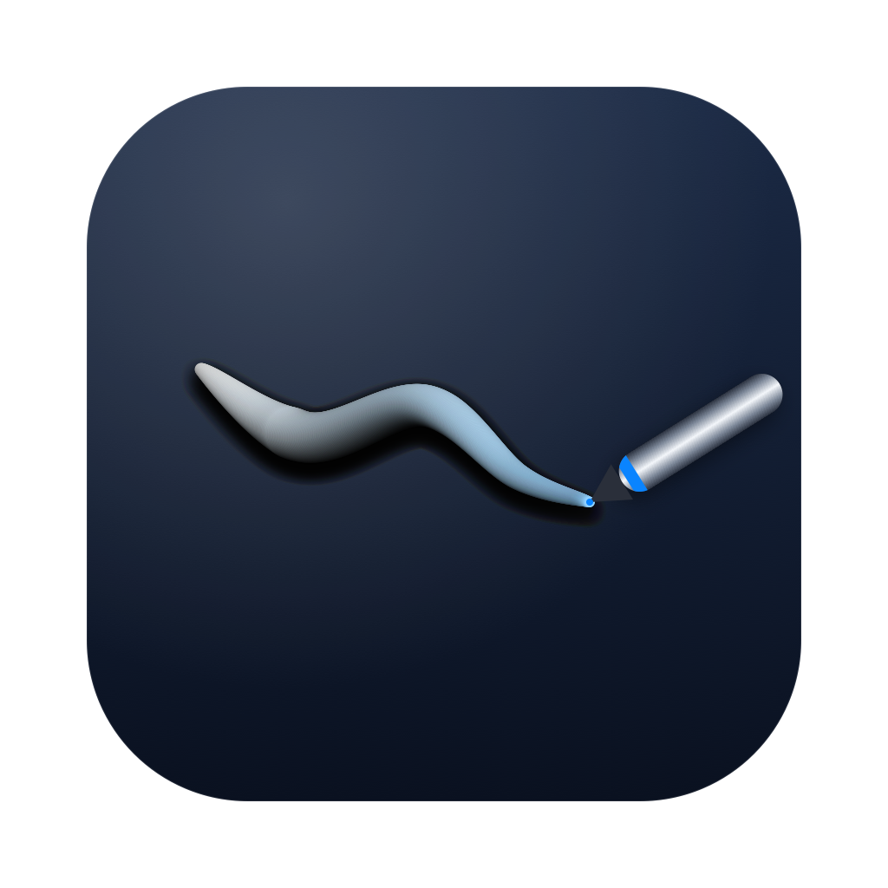
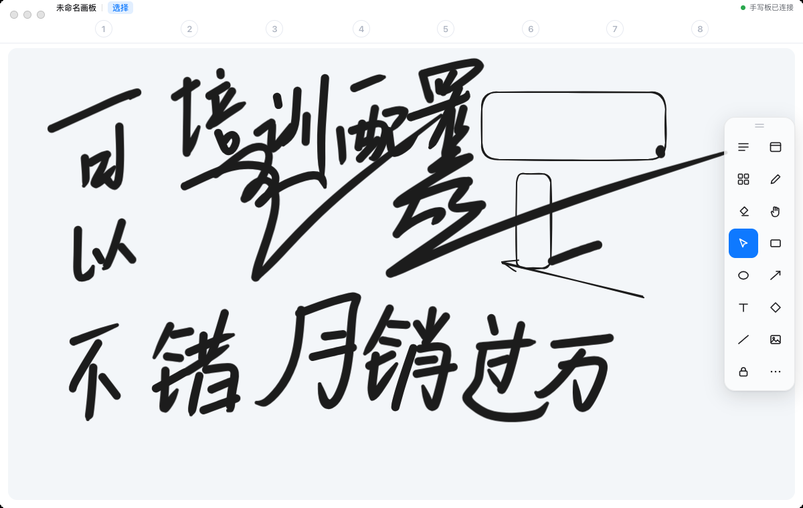
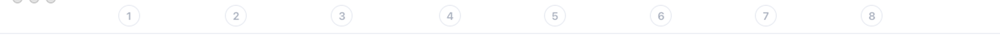

# TabletSketch



面向 **XP-Pen Deco 640** 的独立 macOS 压感草图应用。

窗口本身就是板面：上方一排是手写板 8 个板载键的按键带，下方是 16:9 手写区。笔的坐标只映射到手写区，悬停有跟随圆圈，轻触即出墨，压力控制粗细。



*上图是真机实拍：笔尖在板上走的每一笔，粗细都来自压力值。右上角绿点是板子连接状态，右侧是自绘浮岛工具面板。*

## 它现在能做什么

| 能力 | 状态 |
|---|---|
| 笔悬停圆圈跟随 | ✅ 悬停 14pt 空心环，落笔收成 8pt 实心 |
| 轻触出墨 | ✅ 压力下限 0.35，不需要使劲压 |
| 压感控制粗细 | ✅ 0–16383 级压力，整形后映射到线宽 |
| 笔迹限制在手写区 | ✅ 坐标只映射到 `.ts-stage`，手指不会画出界 |
| 板载 8 键识别 | ✅ 按键带上对应位置亮起 |
| 笔侧键 2 个 | ✅ 侧键 1 呼出两级样式环，侧键 2 弹样式气泡 |
| 鼠标当笔用 | ✅ 左键出墨、右键 / `\` 开样式环，系统箭头与小圆点并存 |
| 压感 / 倾斜读数 | ✅ 右上角实时显示原始压力与倾角 |
| 窗口即板面 | ✅ 上按键带 64pt + 下手写区，比例按真机 |
| 样式环 / 浮岛 / 素材库 | ✅ 两级同心环调样式，不依赖 Excalidraw 原生 chrome |
| 画板存取 | ✅ `.excalidraw` 文件，⌘S 静默保存 |



*按键带常驻显示 1–8，按下时对应位置亮 26pt 主色圆，180ms 后消失。*

## 目标设备

- 型号：XP-Pen Deco 640
- VID / PID：`0x28bd` / `0x2904`
- 有效区：`160 × 90 mm`，原生 **16:9**
- 压感：16384 级（`0..16383`）
- 板载虚拟快捷键：**8 个**
- 笔侧键：**2 个**，可自定义
- 连接：USB HID；不需要 KEXT、DriverKit，也不需要关闭 SIP

本项目**只服务这一台板子**：VID/PID、报文布局、坐标范围、按键数量都按真机硬编码，不做型号探测和多设备兼容（见 `AGENTS.md` R9）。要接第二台设备，属于新需求。

## 为什么单独建仓库

- 不影响既有 `MacAppControlDeck` 的 UI 草图功能。
- 手写板输入、压感、画布锁定、板载键都是高耦合改动，放在独立仓库里迭代更安全。
- 复用宿主项目的 `.excalidraw` 文件格式，未来可择机合并，也可独立发布。

## 怎么跑起来

依赖：macOS、Xcode Command Line Tools（`swift`）、Node.js 18+。

```bash
swift build -c release                 # 编译 Swift HID 采集器
(cd Web/sketch && npm install && npm run build)   # 构建前端到 Resources/Sketch
Scripts/make-app.sh                    # 组装 Build/TabletSketch.app（未签名）
Scripts/install-local.sh               # 固定身份签名 + 覆盖安装到 /Applications 并启动
```

签名身份固定为钥匙串里的 `MacAppControlDeck Self-Signed`（与主项目同一张本机自签证书），不签名不安装。找不到证书会直接失败，不会悄悄降级成 ad-hoc——否则每次重建「输入监控」授权都要重新点一遍。安装后可用 `codesign -d --requirements - /Applications/TabletSketch.app` 确认 designated requirement 是 `certificate root`，不是 `cdhash`。

首次运行需要给 App 授权「输入监控」（系统设置 → 隐私与安全性 → 输入监控）。固定签名后这个授权可以长期复用。

调试开关：

| 环境变量 | 作用 |
|---|---|
| `TS_FAKE=1` | 注入正弦笔迹，没有板子也能看界面 |
| `TS_DUMP=1` | 把 HID 原始报文打到日志 |
| `TS_NO_GRAB=1` | 关闭独占尝试 |
| `TS_DEV=1` | 打开 DevTools |
| `TS_NO_ANIM=1` | 关闭样式环动画，方便截图与验收 |

## 架构

```text
Electron 主进程 (Web/app/main.js)
  ├── spawn → tablet-sketch-hid（Swift，HID 采集）
  │     ├── Digitizer 接口 → 笔坐标 / 压力 / 倾斜 / 悬停
  │     └── Generic Desktop 接口 → 板载 8 键（Report ID 6 键盘报告）
  └── BrowserWindow → Excalidraw 画板 (Web/sketch)
        ├── tablet-sketch.js  笔事件路由、压力整形、工具切换
        └── tablet/*          自绘 chrome：按键带、浮岛、样式环、设置
```

- 前端基于 Excalidraw 0.18.1（`Web/vendor/excalidraw`，submodule，未改源码），原生 UI 由 CSS 隐藏，交互全部自绘。
- 打包产物 `Build/TabletSketch.app` 为手工组装；日常版本由 `Scripts/install-local.sh` 用固定身份 `MacAppControlDeck Self-Signed` 签名后覆盖安装到 `/Applications`。
- 画板默认存到 `~/Pictures/TabletSketch/Sketches/`。

## 仓库结构

```text
TabletSketch/
├── AGENTS.md                  # 开发规则（R0–R9）
├── Sources/
│   ├── TabletSketchHID/       # Swift HID 采集器可执行文件
│   └── TabletSketchCore/      # 报文解析、笔状态机
├── Web/
│   ├── app/                   # Electron 外壳、preload、HID 桥
│   ├── sketch/                # 前端包装层源码
│   └── vendor/excalidraw/     # Excalidraw 0.18.1 submodule
├── Resources/Sketch/          # 前端构建产物（由 vite 输出）
├── Scripts/make-app.sh        # 组装 .app
├── openspec/
│   ├── specs/                 # 稳定能力规格（当前实现行为）
│   └── changes/archive/       # 已完成变更
├── Docs/
│   ├── HANDOFF.md             # 交接文档：做过什么、还剩什么、踩过哪些坑
│   ├── research/              # Deco 640 协议预研
│   └── images/                # README 配图
├── Tools/DecoProbe.swift      # 只读 HID 探针
├── Tools/make-icon.swift      # 自绘应用图标（生成 Resources/AppIcon.icns）
└── Tools/ui-test/main.js      # 离屏 UI 回归（不显示窗口、不启动 HID）
```

## OpenSpec 工作流

任何需求先建变更，再动手：

```text
openspec/changes/<change-id>/     proposal.md / design.md / tasks.md / specs/<capability>/spec.md
        ↓ 完成后
openspec/changes/archive/YYYY-MM-DD-<change-id>/
        ↓ 同步
openspec/specs/<capability>/spec.md
```

已归档 42 个变更，稳定规格 8 份：`pen-input`、`canvas-mapping`、`pen-first-ui`、`sketch-document`、`app-settings`、`express-keys`、`app-lifecycle`、`app-icon`。索引见 `openspec/specs/README.md`。

## 已知限制

这些是实现边界，不是 bug 列表，写在这里免得误解：

1. **板载键会漏到前台应用**。这 8 个键在固件层就是真键盘快捷键，切到浏览器按 7 号键，浏览器也会撤销。
2. **笔仍然驱动系统光标**。Digitizer 与 Generic Desktop 接口的独占在用户态始终返回 `kIOReturnExclusiveAccess`，系统内核 HID 驱动先占。
3. 签名是本机自签（`MacAppControlDeck Self-Signed`），未公证；换机器需要重新信任并授权「输入监控」。
4. 字体仍从 CDN 拉取，与「完全离线」目标有差距。

第 1、2 条的解法与代价见 `Docs/HANDOFF.md` 末尾。

## 路线图

- **P0 / P1 已完成**：只读 HID、压感、轻触起笔、16:9 画布、笔迹限界、板载键、两级样式环、鼠标虚拟笔、浮岛、窗口即板面
- **下一步**：板载键改写成 F13–F20 防外泄、冻结系统光标、签名与图标
- **更远**：压感曲线预设、掌压过滤、平滑与预测、模板

## 不做

系统全局指针接管、KEXT、DriverKit、OCR 手写识别、云同步、多人协作、支持其他型号手写板。

## 许可

沿用 GPL-3.0（见 `LICENSE`）。Excalidraw、React、Vite、字体与素材库的许可见 `THIRD_PARTY_NOTICES.md`。
